<div align="center">



<p>
  <a href="https://github.com/fernata-dev/hads/actions/workflows/ci.yml"></a>
  <a href="https://github.com/fernata-dev/hads/releases/latest"></a>
  <a href="LICENSE"></a>
</p>

**[الموقع](https://fernata-dev.github.io/hads/)** · **[التثبيت](#التثبيت)** · **[الوضع الذكي](#الوضع-الذكي)** · **[English](README.md)**

</div>

<div dir="rtl">

**حدس** ديمون صغير للتيرمنال: بيتعلّم طريقتك في الشغل، بيعرف كل فولدراتك وملفاتك، وبيكتبلك **الأمر
الجاي كامل** كنص باهت قبل ما تكتبه. دوس <kbd>→</kbd> وخلاص.

</div>

<div align="center"></div>

<div dir="rtl">

- **بيتوقّع الأمر كله، مش الكلمة الجاية.** بعد `git commit` بيعرض `git push`، و`cp rep` بتبقى
  `cp Documents/report-2026.pdf ~/Desktop/`: الملف والمكان اللي بتنسخ له دايمًا.
- **عارف الديسك بتاعك.** فهرس هادي لفولدر الهوم في الخلفية: `cd web` بتوديك `~/code/webapp`،
  و`hads find taxes` بيرد في حوالي ملّي ثانية.
- **بيصلّح الغلط قبل ما يحصل.** `gti pu` ← `git push`.
- **فاهم الفولدر اللي انت فيه.** حالة git، سكربتات `package.json`، Rust، Go، Make، Docker Compose.
- **بيفهم عربي وإنجليزي** (اختياري): `? حدّث النظام ونزّل كلود كود` ← خطة أوامر لجهازك انت،
  بتشوفها وبتوافق عليها الأول.
- **خصوصيتك محفوظة.** التوقّع كله على جهازك، والأسرار (توكنز، باسوردات) عمرها ما بتتسجّل.
- **ملف واحد 7 ميجا من غير أي اعتماديات.** macOS · Linux · Windows · FreeBSD، Intel وARM،
  وzsh وbash وfish وPowerShell.

## التثبيت

**macOS · Linux · WSL · FreeBSD**

</div>

```bash
curl -fsSL https://fernata-dev.github.io/hads/install.sh | sh
```

<div dir="rtl">

**Windows** (من PowerShell)

</div>

```powershell
irm https://raw.githubusercontent.com/fernata-dev/hads/main/scripts/install.ps1 | iex
```

<div dir="rtl">

المثبّت بيختار النسخة المناسبة لجهازك، **بيتأكد من الـ SHA-256**، وبعدين يشغّل `hads setup` اللي:

1. بيتعلّم من سجل أوامرك القديم (zsh / bash / fish / PowerShell)، فالتوقعات بتبقى كويسة من أول يوم،
2. بيربط نفسه بكل شِل عندك (بلوك واضح في ملف الـ rc مع نسخة احتياطية)،
3. بيخلّي الديمون يشتغل مع تشغيل الجهاز،
4. بيعرض عليك تفعيل الوضع الذكي (اختياري).

افتح تيرمنال جديد وابدأ اكتب.

## الاستخدام

| | zsh | bash | fish | PowerShell |
|---|---|---|---|---|
| التوقّع بيظهر | وانت بتكتب | لما تطلبه | على يمين السطر | لما تطلبه |
| تقبله | <kbd>→</kbd> | <kbd>Ctrl</kbd>+<kbd>Space</kbd> | <kbd>Ctrl</kbd>+<kbd>Space</kbd> | <kbd>Ctrl</kbd>+<kbd>Space</kbd> |
| بدائل | <kbd>Alt</kbd>+<kbd>N</kbd> | <kbd>Alt</kbd>+<kbd>N</kbd> | <kbd>Alt</kbd>+<kbd>N</kbd> | <kbd>Alt</kbd>+<kbd>N</kbd> |
| الوضع الذكي | `? طلبك` | `ask طلبك` | `? طلبك` | `? طلبك` |

</div>

```console
$ hads suggest          # غالبًا هتعمل إيه بعد كده، وليه
$ hads find فاتورة       # بحث فوري في ملفاتك
$ hads status           # حالة الديمون والنموذج والفهرس
```

<div dir="rtl">

## الوضع الذكي

مقفول لحد ما تشغّل `hads agent enable` وتدخّل مفتاح [OpenRouter](https://openrouter.ai/keys). بعدها
اكتب اللي عايزه بالعربي أو الإنجليزي أو الاتنين مع بعض:

</div>

```console
$ ? حدّث النظام ونزّل كلود كود وسطّبه
$ ? انسخ آخر فاتورة PDF على سطح المكتب
$ ? update the os and install claude code
```

<div dir="rtl">

- **بيخطط لجهازك انت:** بيعرف نظامك والتوزيعة ومدير الباكدجات المتاح (pacman، apt، brew، winget…).
- **مفيش حاجة بتتنفّذ من غير موافقتك:** الكل، أو خطوة بخطوة، أو إلغاء. و`--dry-run` بيعرض الخطة بس.
- **حماية محلية الموديل مايقدرش يتخطّاها:** الأوامر المدمّرة (`rm -rf /`، `mkfs`، `dd` على ديسك…)
  ممنوعة تمامًا، والخطيرة لازم تكتب `yes` عشان تتنفذ.
- **بيصلّح الفشل:** لو خطوة فشلت بيبعت الخطأ للموديل ويعرض عليك الحل.

الموديل الافتراضي `anthropic/claude-sonnet-5.5`، وتقدر تغيّره بـ `hads agent model <id>`.

## إزاي شغّال

التوقّع نموذج إحصائي صغير على **أوامرك انت**، مش موديل كبير، وعشان كده هو فوري وخاص بيك. بيحسب
من: تسلسل أوامرك (n-gram)، الأحدث والأكتر استخدامًا (frecency)، الفولدر الحالي، فهرس الملفات،
الأماكن اللي بتنسخ لها عادةً، وقواعد ذكية (git، المشاريع، الأخطاء الإملائية).

اتقاس على لابتوب من 2014 (Intel i5-4210M): حوالي **12 ميكروثانية** للتوقّع جوه النموذج، وحوالي
**4 ملّي ثانية** لكل ضغطة زرار من أولها لآخرها.

## الخصوصية

- التوقّع والسجل والفهرس عمرهم ما بيخرجوا من جهازك.
- أي أمر شكله فيه سر (توكن، باسورد، مفتاح API) **مابيتسجّلش أبدًا**، والسطر اللي بيبدأ بمسافة بيفضل خاص.
- الوضع الذكي اختياري. لما تستخدمه بيتبعت لـ OpenRouter طلبك، ووصف لجهازك (النظام، الشِل، مديري
  الباكدجات، أسماء فولدرات الهوم الرئيسية)، ونتايج البحث في الملفات لو طلبها.

## إزالة البرنامج

</div>

```bash
hads uninstall --purge && rm "$(command -v hads)"
```

<div dir="rtl">

## الرخصة

[MIT](LICENSE)

</div>
