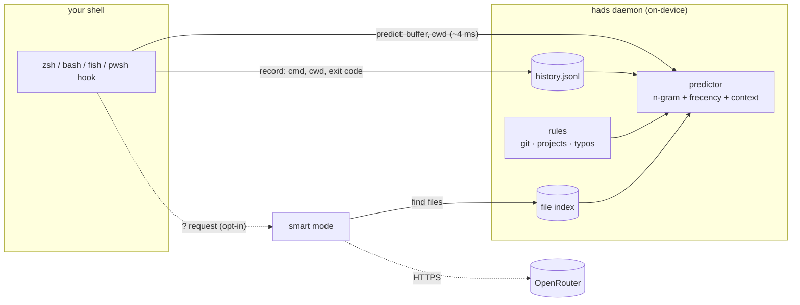

<div align="center">



<p>
  <a href="https://github.com/fernata-dev/hads/actions/workflows/ci.yml"></a>
  <a href="https://github.com/fernata-dev/hads/releases/latest"></a>
  
  
  <a href="LICENSE"></a>
</p>

**[Website](https://fernata-dev.github.io/hads/)** · **[Install](#install)** · **[How it works](#how-it-works)** · **[Smart mode](#smart-mode-arabic--english)** · **[العربية](README.ar.md)**

</div>

---

**hads** (Arabic *حدس*, "intuition") is a tiny daemon for your terminal. It learns how *you* work,
maps the folders and files you own, and writes the **whole next command** as ghost text before you
type it. Press <kbd>→</kbd> and it's yours.

<div align="center"></div>

- **Predicts the full command, not the next word.** After `git commit` it already shows `git push`;
  `cp rep` becomes `cp Documents/report-2026.pdf ~/Desktop/`, the file *and* where you always put it.
- **Knows your disk.** A gentle background index of your home folder: `cd web` jumps to
  `~/code/webapp`, `hads find taxes` answers in about a millisecond.
- **Fixes typos before they fail.** `gti pu` → `git push`, completed from your own history.
- **Reads the room.** Git state, `package.json` scripts, `Cargo.toml`, `go.mod`, `Makefile`,
  Compose files: the right command for the folder you just walked into.
- **Speaks Arabic and English** (opt-in). `? حدّث النظام ونزّل كلود كود` plans the exact commands for
  *your* OS, shows them, and runs them only after you say yes.
- **Private by design.** Prediction is 100% on-device. Secrets never reach the model or the disk.
- **One 7 MB binary, zero dependencies.** macOS, Linux, Windows, FreeBSD · x86-64 and ARM ·
  zsh, bash, fish, PowerShell.

## Install

**macOS · Linux · WSL · FreeBSD**

```bash
curl -fsSL https://fernata-dev.github.io/hads/install.sh | sh
```

**Windows** (PowerShell)

```powershell
irm https://raw.githubusercontent.com/fernata-dev/hads/main/scripts/install.ps1 | iex
```

The installer picks the right build for your OS and CPU, **verifies its SHA-256**, puts `hads` in
`~/.local/bin` (`%LOCALAPPDATA%\hads\bin` on Windows), then runs `hads setup`, which:

1. imports your existing zsh / bash / fish / PowerShell history, so predictions are good on day one,
2. wires itself into every shell it finds (a marked block in your rc file, with a backup),
3. registers the daemon to start at login (systemd `--user`, launchd, or the Windows Startup folder),
4. offers to turn on smart mode (optional).

Open a new terminal and start typing.

<details>
<summary><b>Manual download, pinned versions, mirrors</b></summary>

| OS | x86-64 | ARM |
|---|---|---|
| macOS | [hads-darwin-amd64](https://github.com/fernata-dev/hads/releases/latest/download/hads-darwin-amd64) | [hads-darwin-arm64](https://github.com/fernata-dev/hads/releases/latest/download/hads-darwin-arm64) |
| Linux | [hads-linux-amd64](https://github.com/fernata-dev/hads/releases/latest/download/hads-linux-amd64) | [arm64](https://github.com/fernata-dev/hads/releases/latest/download/hads-linux-arm64) · [armv7](https://github.com/fernata-dev/hads/releases/latest/download/hads-linux-arm) |
| Windows | [hads-windows-amd64.exe](https://github.com/fernata-dev/hads/releases/latest/download/hads-windows-amd64.exe) | [hads-windows-arm64.exe](https://github.com/fernata-dev/hads/releases/latest/download/hads-windows-arm64.exe) |
| FreeBSD | [hads-freebsd-amd64](https://github.com/fernata-dev/hads/releases/latest/download/hads-freebsd-amd64) | |

Checksums: [`checksums.txt`](https://github.com/fernata-dev/hads/releases/latest/download/checksums.txt).
Then `chmod +x` it, put it on your `PATH` as `hads`, and run `hads setup`.

Installer options (environment variables):

| Variable | Effect |
|---|---|
| `HADS_VERSION=v1.0.0` | install a specific release |
| `HADS_BIN_DIR=/usr/local/bin` | install somewhere else |
| `HADS_SETUP_ARGS="--yes --no-service"` | non-interactive setup, no login autostart |
| `HADS_DL_URL=https://mirror/...` | download binaries + checksums from a mirror |

From source (Go 1.24+): `git clone https://github.com/fernata-dev/hads && cd hads && make build && ./hads setup`.
</details>

## Using it

| | zsh | bash | fish | PowerShell |
|---|---|---|---|---|
| Prediction appears | as ghost text while you type | on demand | on the right prompt | on demand |
| Accept | <kbd>→</kbd> / <kbd>End</kbd> | <kbd>Ctrl</kbd>+<kbd>Space</kbd> | <kbd>Ctrl</kbd>+<kbd>Space</kbd> | <kbd>Ctrl</kbd>+<kbd>Space</kbd> |
| Other predictions | <kbd>Alt</kbd>+<kbd>N</kbd> / <kbd>Alt</kbd>+<kbd>P</kbd> | <kbd>Alt</kbd>+<kbd>N</kbd> | <kbd>Alt</kbd>+<kbd>N</kbd> | <kbd>Alt</kbd>+<kbd>N</kbd> |
| Smart mode | `? request` | `ask request` | `? request` | `? request` |

On an empty line the prediction is *what you'll do next*. While typing it's *how this line ends*.
Already use **zsh-autosuggestions**? hads plugs in as its first strategy instead of replacing it.

```console
$ hads suggest            # what's next here, and why
$ hads suggest cp rep     # how would you finish this line?
$ hads find invoice       # instant search over your folders
$ hads status             # daemon, model and index
```

<details>
<summary><b>All commands</b></summary>

| Command | What it does |
|---|---|
| `hads setup [--yes] [--no-shell] [--no-service]` | install hooks + autostart, import history |
| `hads status` | daemon, learned commands, index size, smart mode |
| `hads suggest [text]` | ranked predictions with the reason for each |
| `hads find <name> [--dirs] [--plain]` | search the file index |
| `hads ask <request> [--yes] [--dry-run] [--model id]` | smart mode (also `hads do`, or just `hads <arabic text>`) |
| `hads explain <command>` | explain what a command will do, in your language |
| `hads agent enable \| disable \| status \| model <id> \| test \| forget-key` | manage smart mode |
| `hads init zsh\|bash\|fish\|pwsh` | print the shell integration |
| `hads import` | re-import shell histories |
| `hads reindex` | rescan your folders now |
| `hads start \| stop \| restart` | control the daemon (`stop` keeps it stopped) |
| `hads uninstall [--purge]` | remove hooks and autostart (`--purge` deletes learned data) |
</details>

## Smart mode (Arabic & English)

Off until you run `hads agent enable` with an [OpenRouter](https://openrouter.ai/keys) key (or set
`OPENROUTER_API_KEY`). Then write what you want, in any mix of Arabic and English:

```console
$ ? حدّث النظام ونزّل كلود كود وسطّبه
$ ? update the os and install claude code on my laptop
$ ? copy my latest invoice pdf to the desktop
```

```text
  ◆ حدس · الوضع الذكي
  الطلب    حدّث النظام ونزّل كلود كود وسطّبه
  الجهاز   CachyOS · amd64 · fish · pacman, paru

   1  تحديث النظام بالكامل                    sudo · متوسط
      $ sudo pacman -Syu --noconfirm
   2  تثبيت Claude Code بالمثبّت الرسمي         متوسط
      $ curl -fsSL https://claude.ai/install.sh | bash
   3  التأكد من التثبيت                          آمن
      $ claude --version

  أنفّذ؟  [Enter/y] الكل · [s] خطوة بخطوة · [n] إلغاء  ›
```

How it stays safe:

- **It plans for this machine.** The model is given your OS, distro, CPU, shell, available package
  managers and tools, so it writes `pacman` on Arch, `apt` on Ubuntu, `brew` on macOS, `winget` on Windows.
- **Nothing runs until you approve.** Run all, go step by step, or cancel. `--dry-run` only shows the plan.
- **A local guard the model can't override.** Destructive patterns (`rm -rf /`, `mkfs`, `dd` to a
  disk, fork bombs, `Format-Volume`, …) are **blocked**. Risky ones (recursive deletes, force-push,
  package removal, piping unknown scripts into a shell) need you to type `yes`.
- **It repairs failures.** If a step fails, hads sends the error tail back, shows the proposed fix
  and asks again (up to 2 rounds, configurable).
- **It can look things up on your disk.** For file tasks the model asks hads to search the index and
  plans with real paths.

Default model: `anthropic/claude-sonnet-5.5`. Any OpenRouter model works: `hads agent model <id>`.

## How it works



The predictor is a small statistical language model over **your own** command stream, not a
large model, and that's why it's instant and private. Every candidate is scored from:

| Signal | Example |
|---|---|
| bigram / trigram transitions | `git add` → `git commit` → `git push` |
| frecency (14-day half-life) | what you've been running lately |
| folder context | what you usually run *in this directory* |
| file index + path usage | the files you actually touch rank first |
| learned destinations | where *you* `cp` and `mv` things to |
| rules | git ahead/behind/dirty, project files, `mkdir x` → `cd x`, `git clone` → `cd repo` |
| failure history | commands that keep failing sink; `exit 127` triggers a typo fix |

Measured on a 2014 laptop (Intel i5-4210M, Linux, 1,100 learned commands): **~12 µs** per prediction inside the
model, **~4 ms** per keystroke end to end including starting the client. The index scan is
throttled and runs at low priority.

## Privacy

- Prediction, history and the file index never leave your machine.
- Commands that look like secrets (tokens, `password=`, `Authorization:` headers, `user:pass@` URLs,
  `sk-…`, `ghp_…`, AWS keys, …) are **never stored**. Lines starting with a space are private, as in
  your shell.
- Data lives in `~/.config/hads` (macOS: `~/Library/Application Support/hads`, Windows:
  `%AppData%\hads`) with `0600` permissions; the daemon socket is user-only.
- Smart mode is opt-in. When you use it, your request, a description of your system (OS, shell,
  package managers, top-level home folder names) and any file search results it asks for are sent to
  OpenRouter and the model you picked.

## Configuration

`~/.config/hads/config.json`:

```jsonc
{
  "roots": ["~"],              // folders to index
  "exclude": ["node_modules", ".git", "~/Library", "..."],
  "max_files": 250000,
  "max_depth": 14,
  "rescan_minutes": 30,
  "agent": {
    "enabled": false,
    "model": "anthropic/claude-sonnet-5.5",
    "base_url": "https://openrouter.ai/api/v1",   // any OpenAI-compatible endpoint
    "auto_fix": true,
    "max_fix_attempts": 2
  }
}
```

Environment: `HADS_HOME` (data dir), `HADS_LANG=ar|en` (interface language), `OPENROUTER_API_KEY`,
`NO_COLOR`, and in zsh `HADS_GHOST_STYLE` (default `fg=8`). In fish, `set -g hads_no_hint 1` hides
the right-prompt hint.

## Development

```bash
make test      # go vet + tests (+ race on Linux)
make build     # ./hads for this machine
make dist      # every platform into dist/ with checksums
```

```
cmd/hads/            CLI
internal/daemon/     long-running server, autostart, process control
internal/model/      predictor, rules, tokenizer, i18n
internal/index/      file index + ranking
internal/history/    store, secret filter, zsh/bash/fish/pwsh importers
internal/shell/      shell integrations (embedded scripts) + rc file management
internal/agent/      smart mode: OpenRouter client, planner, safety guard, executor
internal/ipc/        JSON-lines over a unix socket (loopback + token on Windows)
internal/service/    systemd / launchd / Startup folder
site/                landing page (GitHub Pages)
scripts/             installers and the cross-build
```

Contributions are welcome: see [CONTRIBUTING.md](CONTRIBUTING.md). Security reports:
[SECURITY.md](SECURITY.md).

## Uninstall

```bash
hads uninstall --purge && rm "$(command -v hads)"
```

## License

[MIT](LICENSE)
